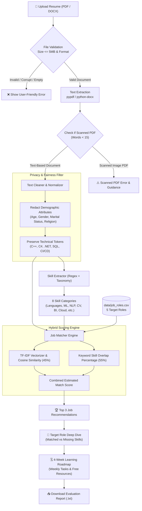

# 🚀 AI Resume Analyzer and Job Recommendation System

An intelligent, privacy-first software web application designed to parse PDF and DOCX resumes, extract technical skills across 8 domains, match candidate profiles against key Data and AI job roles using **TF-IDF & Cosine Similarity**, and generate an actionable **4-week learning roadmap** to bridge detected skill gaps.

---

## 💡 Simple Tanglish Explanation (Beginner-Friendly Guide)

> **Vanakkam! Idhu oru complete AI & NLP Resume Analyzer project.**
> Neenga programming-ku puthusu-naalum kavalapadatheenga. Step-by-step-aa intha project epdi work aaguthu-nu paarkalaam:

1. **Resume Extraction (PDF & Word):** Unga resume PDF or DOCX file upload pannum pothu, `pypdf` and `python-docx` tools use panni file-la irukura ella words-aiyum extract pannuvom. Oruvela scanned/image-only PDF upload pannina, system kandupudichu clear error message kaattum.
2. **Text Cleaning & Symbol Protection:** Normal regex standard punctuation-ai remove pannum pothu `C++`, `C#`, `.NET`, `SQL`, `CI/CD` maathiri important programming terms azhinju pogum. Athanaala namma algorithm indha terms-ai special tokens-aa mask panni preserve pannum!
3. **Fair Evaluation (No Bias):** Unga gender, age, religion, marital status, photo ethuvume scoring-la eduthukka maattom. Strictly technical skills mattume calculate aagum.
4. **Skill Taxonomy Extraction:** 90+ skills taxonomy vachi resume-la irukura technical skills-ai detect panni categories-la (Programming, ML, BI, Cloud) group pannum.
5. **TF-IDF & Cosine Similarity:** Machine Learning algorithm unga resume text-aiyum job requirements-aiyum mathematical numbers-aa (vectors) maathi compare pannum. Top 3 suitable job roles recommend pannum.
6. **4-Week Learning Roadmap:** Target job-ku missing-aa irukura skills-ai 4 weeks-la step-by-step-aa padikka free resources and practical project tasks provide pannum!

---

## 🏗️ System Workflow Architecture



---

## 📂 Project Folder Structure

```text
ai_resume_analyzer/
│
├── app.py                     # Streamlit Interactive Dashboard
├── resume_parser.py           # Multi-format Ingestion (PDF & DOCX)
├── text_cleaner.py            # NLP Normalization & Symbol Preservation
├── skill_extractor.py         # 90+ Categorized Skill Taxonomy Matcher
├── job_matcher.py             # TF-IDF & Cosine Similarity Scoring Engine
├── roadmap_generator.py       # 4-Week Progressive Learning Roadmap Engine
├── requirements.txt           # Python Package Dependencies
├── README.md                  # Comprehensive Documentation
├── .gitignore                 # Version Control Ignore Rules
│
├── data/
│   ├── job_roles.csv          # 5 Standard Data & AI Job Profiles
│   └── skill_dictionary.csv   # 90+ Skill Taxonomy with Aliases
│
├── sample_resumes/            # Sample Resumes for Rapid Testing
│   ├── sample_data_analyst.docx
│   ├── sample_ml_engineer.docx
│   ├── sample_nlp_engineer.docx
│   ├── sample_cv_engineer.docx
│   └── sample_empty_scanned.pdf
│
├── reports/                   # Output Directory for Downloaded Reports
│   └── .gitkeep
│
└── tests/
    ├── test_cases.csv         # Structured Test Case Sheet (11 Test Cases)
    └── run_tests.py           # Automated Test Suite Runner
```

---

## 🛠️ Step-by-Step Windows Terminal Setup

### 1. Open Windows PowerShell or Command Prompt
Navigate to your project directory:
```powershell
cd c:\Users\syeds\OneDrive\Desktop\project\ai_resume_analyzer
```

### 2. Activate the Python Virtual Environment
A virtual environment has already been created in `.venv`:
```powershell
# In PowerShell:
.\.venv\Scripts\Activate.ps1

# In Command Prompt (cmd.exe):
.\.venv\Scripts\activate.bat
```
*(If PowerShell displays an `Execution_Policies` restriction, run: `Set-ExecutionPolicy -Scope Process -ExecutionPolicy Bypass` and then run the activation script again).*

### 3. Install Dependencies (If not already installed)
```powershell
pip install -r requirements.txt
```

### 4. Run Automated Unit & Integration Tests
Verify that all 11 test cases pass:
```powershell
python tests\run_tests.py
```
Expected output:
```text
======================================================================
TEST SUMMARY: 11 PASSED, 0 FAILED (TOTAL 11)
======================================================================
```

### 5. Launch the Streamlit Web Application
Run the Streamlit application:
```powershell
streamlit run app.py
```
Streamlit will automatically open your default browser at:
`http://localhost:8501`

---

## 🧪 Testing with Sample Resumes

You do not need an external resume file to test the application! The sidebar includes preloaded sample resumes:
1. **Data Analyst Profile (DOCX):** Demonstrates high alignment with SQL, Tableau, Power BI, and Pandas.
2. **Machine Learning Engineer Profile (DOCX):** Demonstrates alignment with Scikit-Learn, Docker, and XGBoost.
3. **NLP & AI Engineer Profile (DOCX):** Demonstrates alignment with Transformers, BERT, and PyTorch.
4. **Computer Vision Profile (DOCX):** Demonstrates alignment with OpenCV, YOLO, and CNNs.
5. **Empty / Scanned PDF (Test Error Handling):** Demonstrates defensive error handling and friendly guidance for scanned documents.

---

## 🔒 Privacy & Fairness Guarantees

1. **In-Memory Document Ingestion:** Uploaded resumes are read as in-memory byte streams and discarded when the session ends. No resumes are written to permanent server disks.
2. **No PII Logging:** Personally identifiable information (such as phone numbers, emails, addresses) is stripped out during preprocessing and never logged.
3. **Anti-Bias Filtering:** Protected personal characteristics (gender, date of birth, age, marital status, nationality, religion, disability) are explicitly removed from text matching to prevent discriminatory skewing.

---

## ⚠️ Match Score Disclaimer

> **Important Notice:** The estimated match score is a text-similarity heuristic based on keyword extraction and TF-IDF cosine similarity. It is **not** a hiring probability, an employment guarantee, or a full measure of a candidate's practical problem-solving capability. Missing keywords in a resume do not mean a candidate cannot perform the role.

---

## 🐙 Git and GitHub Setup Instructions

To push this project to your GitHub account:

```powershell
# 1. Initialize git repository inside ai_resume_analyzer
git init

# 2. Add all files to staging
git add .

# 3. Create your first commit
git commit -m "feat: complete AI resume analyzer and job recommendation system"

# 4. Rename default branch to main
git branch -M main

# 5. Link your GitHub remote repository (replace with your repo URL)
git remote add origin https://github.com/YOUR_USERNAME/ai-resume-analyzer.git

# 6. Push code to GitHub
git push -u origin main
```
